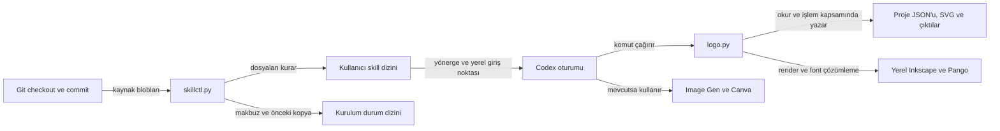
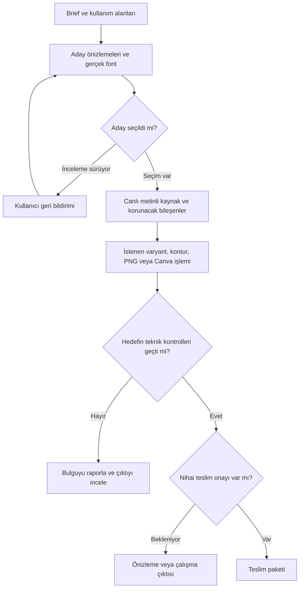
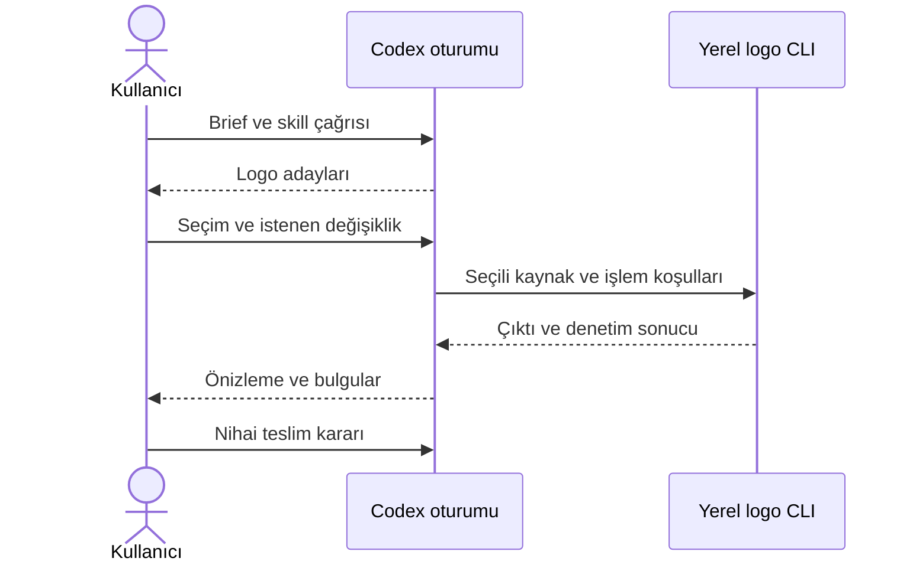

# Logo Master mimarisi ve iş akışı

## Mimari

Hangi bileşen hangi dosyayı okur veya yazar?

| Bileşen | Sorumluluk ve veri sınırı | Kaynak |
| --- | --- | --- |
| Kurulum | Git nesnelerini ve VERSION'ı okur. Kullanıcı skill dizinine dosya, ayrı durum dizinine makbuz ve önceki kopya yazar. | [Kurulum aracı](../tools/skillctl.py) · [Sürüm sözleşmesi](versioning.md) |
| Codex | Kullanıcının brief ve seçimine göre yönergeleri, yerel komutları ve oturumda mevcut bağlı araçları kullanır. | [Skill](../skills/logo-master/SKILL.md) |
| Yerel CLI | Proje JSON'unu ve varlıkları denetler. Komuta göre SVG, PNG, JSON makbuzu, yerel pano veya ZIP oluşturur. Çıktı konumları komut argümanlarından gelir. | [CLI](../skills/logo-master/scripts/logo.py) · [Üretim komutları](../skills/logo-master/references/production.md) |
| Geometri ve tipografi | Inkscape ile render ve kontur, Pango ile font çözümleme yapılır. Aynı dosya üzerindeki teknik kontrolleri yeniden çalıştırmak mümkündür. | [Renderer](../skills/logo-master/scripts/logo_core/render.py) · [Vektör rehberi](../skills/logo-master/references/local-vector.md) |
| Canva | Yerel CLI, aktarılacak dosyayı ve indirilen PDF'yi inceleyebilir. Canva'daki yerleştirme, düzenleme, kaydetme ve indirme Codex oturumundaki erişime bağlıdır. | [Yerel Canva işlemleri](../skills/logo-master/scripts/logo_core/canva.py) · [Canva rehberi](../skills/logo-master/references/canva.md) |

Çizim kurulu skill'in kullanıldığı yolu gösterir. Geliştirme testleri ise CLI'yi doğrudan checkout'tan çalıştırır.

## Tasarım ve üretim akışı

Skill çağrıldıktan sonra bir aday hangi adımlardan geçer?

Akış seçimden sonra yürütülen üretimi gösterir. Yerel CLI arşiv, sunum ve teslim kapsamlarını [ayrı kurallarla](../skills/logo-master/references/production.md) ele alır. Kurulum ve sürüm değiştirme adımları [kurulum rehberindedir](../INSTALL.md).

## Kim başlatır, kim karar verir?

Kullanıcı tasarımı seçer ve nihai teslimi onaylar. Codex teknik işlemleri sıralar ve sonuçlarını sunar. CLI her çağrıda kendi işleminin sonucunu döndürür. Kurulum aracı ayrı çağrılır. Logo işlerini yöneten kalıcı bir servis veya dahili ajan takımı bulunmaz.
